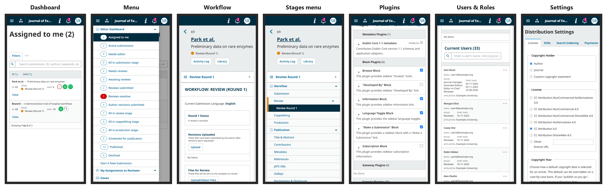
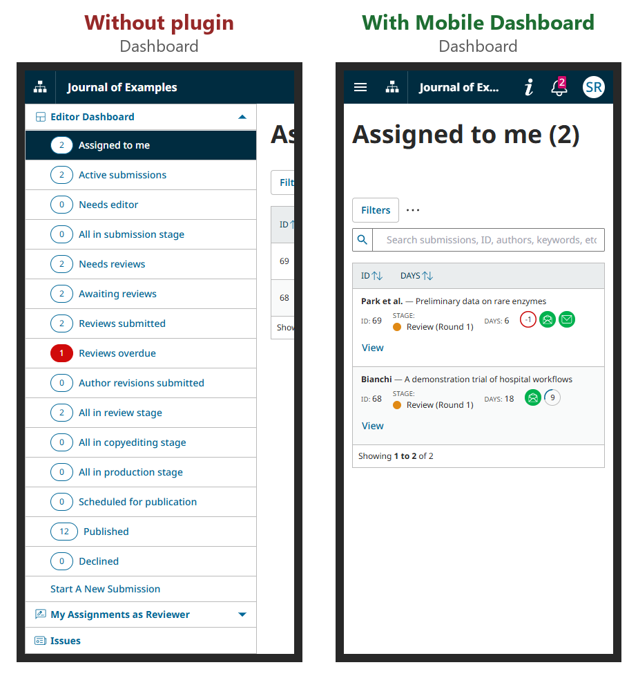
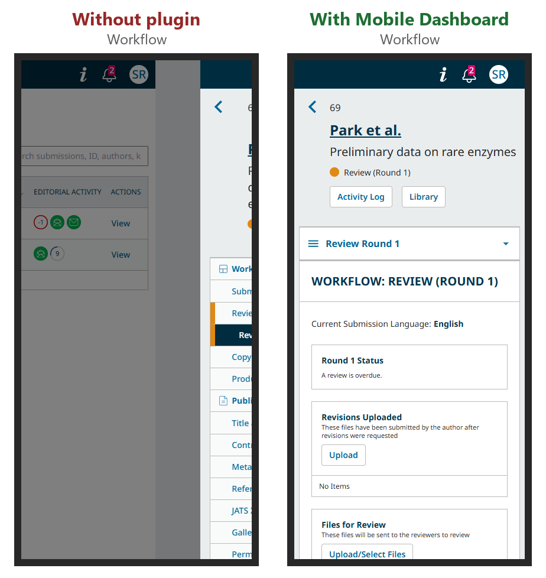
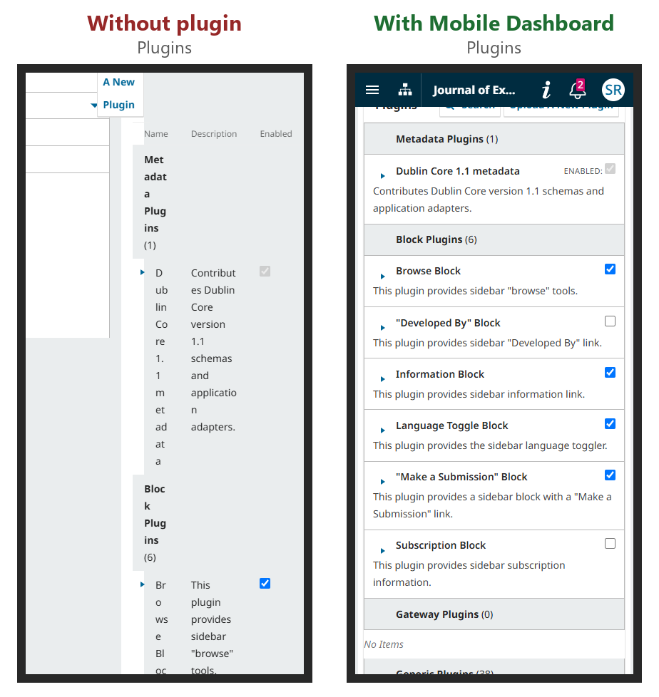
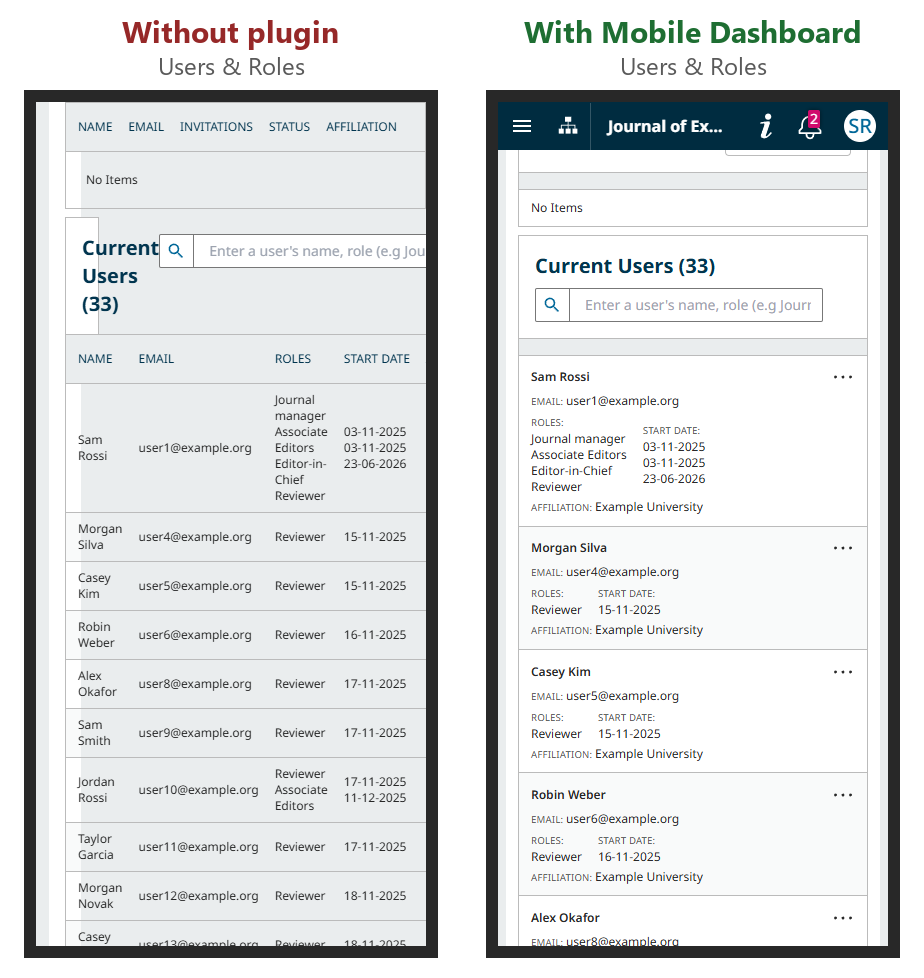
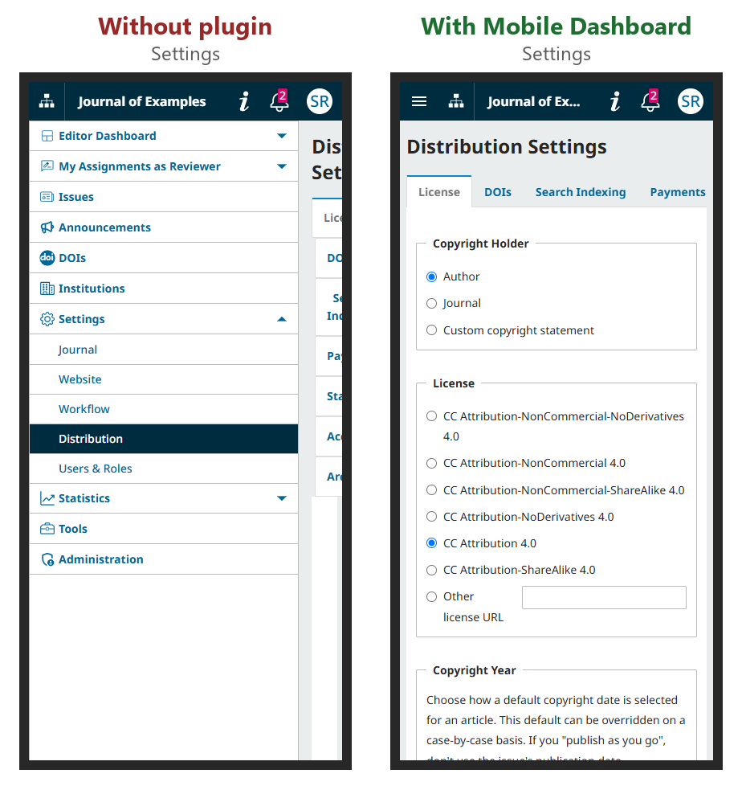

<!--
README.md
Copyright (C) 2026 Stefano Natangelo
SPDX-License-Identifier: AGPL-3.0-only
-->

# Mobile Dashboard for OJS

[](#compatibility)
[](https://github.com/SNatangelo/ojs-mobile-dashboard/releases/tag/v1.0.0.2)
[](LICENSE)

Mobile Dashboard is a site-wide plugin for [Open Journal Systems (OJS)](https://pkp.sfu.ca/software/ojs/) that makes the editorial back end comfortable to use **on a phone**.

Editors, journal managers and site administrators can follow submissions, open the workflow and change settings from a phone without zooming in or scrolling sideways. On a computer nothing changes.

## Features

- A ☰ menu that slides in from the left, stays inside the screen, scrolls down to the last item and closes with a tap outside.
- A collapsible workflow stage bar that closes again once a stage is chosen.
- Pages and dialogs that fit the width of the screen; wide tables scroll inside their own box.
- Submission lists, workflow grids and other tables shown as cards, with each value labelled.
- Plugin lists (journal, Plugin Gallery and site administration) with the name and checkbox on one line and the full description below.
- Users & Roles shown as one card per user, with the name in bold on top.
- Settings and profile forms that use almost the whole width of the screen, one field per line.
- Tabs on one row that scrolls sideways and stays below the header; a sideways swipe on the page opens the next or previous tab, inner tabs first, as in phone apps.
- Tasks, statistics and list pages without boxes inside boxes or headings that repeat the page title; Editorial Activity as a ring sized to the screen, with the total below it and the stages beside it; statistics tables as compact rows.
- No changes above 900 px: on a computer OJS looks exactly as it does without the plugin.
- No settings, no database tables and no external services.
- English and Italian interfaces.

## Screenshots

The screenshots below use fictional journals, users and submissions from a local OJS 3.5 test installation. They do not show hosted journals or production data.

**On a phone — dashboard, menu, workflow, stage menu, plugins, users and settings**



## Without vs. with Mobile Dashboard

The same pages on a 390 × 844 phone screen, without the plugin (left) and with it (right).

**Editorial dashboard** — the side menu no longer covers the page and the submission list becomes cards.



**Submission workflow** — the stage menu folds into one bar and the page fits the screen.



**Plugins** — names and checkboxes on one line instead of a few letters per line.



**Users & Roles** — one card per user instead of a table that runs off the screen.



**Settings** — the side menu no longer covers the form, the tabs sit on one row that scrolls sideways and stays below the header, and the fields use the width of the screen.



## Compatibility

Version **1.0.0** was developed for **OJS 3.5.0-6**. Development builds are installed and functioning on **JSENetwork with MySQL 8**, where they are used on real phones; development testing used a separate local OJS 3.5.0-6 Docker installation with MariaDB, in Chrome with a simulated 390 × 844 phone screen and at 1300 px on a computer.

Version **1.0.0.1** is a maintenance release with unchanged runtime PHP, CSS, JavaScript and translations. It adds release packaging and documentation for PKP Plugin Gallery submission. The development and deployment evidence above concerns the initial release; a fresh installation and upgrade of the new archive must be verified separately.

Version **1.0.0.2** makes the phone ☰ menu more robust when another stylesheet also styles `#app-nav` (for example a narrow column width or a low z-index): a few structural properties of the drawer are now `!important`, inside the phone media query only. The desktop layout is unchanged.

Other OJS versions and database engines beyond MySQL/MariaDB have not yet been verified.

## Installation and quick start

1. Download [mobileDashboard-1.0.0.2.tar.gz](https://github.com/SNatangelo/ojs-mobile-dashboard/releases/download/v1.0.0.2/mobileDashboard-1.0.0.2.tar.gz), the installable release package, rather than GitHub's automatic **Source code** downloads.
2. Install the archive through the OJS plugin management interface (**Upload A New Plugin**) as a **site administrator**.
3. Enable **Mobile Dashboard** in the list of generic plugins. It is a site-wide plugin: one switch covers every journal and the site administration pages.
4. Open the back end on a phone and reload the page.

For manual installation, the plugin directory must be `plugins/generic/mobileDashboard`, with `version.xml` directly inside it. Complete installation through OJS so the plugin version is registered.

## Upgrading

Install the newer release archive through the same OJS plugin management interface; OJS recognises it as an upgrade of the installed version.

Style and script URLs carry the plugin version, so phones load the new files after an upgrade instead of an old cached copy.

If you replace the files by hand, complete the upgrade with:

```
php lib/pkp/tools/installPluginVersion.php plugins/generic/mobileDashboard/version.xml
```

## Disabling and uninstalling

**Disabling** the plugin in the plugin list restores the standard OJS layout on phones immediately. The plugin changes only the look of the back end: no journal data, submission or setting is altered.

**Deleting** the plugin in OJS removes its files. Two rows stay in the database; nothing reads them once the plugin is gone, but you can remove them:

```
DELETE FROM plugin_settings WHERE plugin_name = 'mobiledashboardplugin';
DELETE FROM versions WHERE product = 'mobileDashboard';
```

If your tables use a prefix, add it to the table names first.

## How it works

The plugin adds one stylesheet and one script to back-end pages:

| File | Role |
|---|---|
| `styles/mobile.css` | the phone layout; every rule sits inside `@media (max-width: 900px)`, except for the hidden elements the plugin creates |
| `styles/mobile.js` | the ☰ button and its backdrop, the stage bar, the labels of table cards and swiping between tabs |
| `MobileDashboardPlugin.php` | adds both files to back-end pages while the plugin is enabled |

Public journal pages, the reader interface and the theme are not touched.

## Privacy and data handling

Mobile Dashboard adds a locally served stylesheet and script to existing OJS back-end pages. The script uses information already rendered in the page to adjust navigation, labels and layout. The plugin creates no additional database tables, stores no additional user data, and does not introduce external requests, analytics, telemetry or third-party data processing. Standard OJS authentication, access control, and data processing remain unchanged.

The plugin has no additional settings, third-party accounts, subscriptions or runtime dependencies. Browser and Docker tools are used only for development testing.

## Testing and known limitations

The [automated browser suite](https://github.com/SNatangelo/ojs-mobile-dashboard/blob/main/tests/README.md) runs against a local OJS 3.5.0-6 Docker copy with placeholder data. It defines **158 checks**: **11 on files and the installed plugin**, **130 on a simulated phone** (390 × 844, with simulated touches for the tab swipes) and **17 on a computer**, where 17 pages and dialogs are captured at 1300 px with and without the plugin and must be identical pixel by pixel. These are suite counts, not an execution report.

The CI workflow checks PHP and JavaScript syntax, Bash syntax, that `mobile.css` changes nothing above 900 px, the version format, that the English and Italian strings match, and file headers. It does not start Docker or OJS; the browser suite is **not run by CI**.

- The suite simulates a phone in desktop Chrome; real phones and mobile browsers are checked by hand on the live installation.
- OJS pages that were not part of the suite may still need adjustments on narrow screens.
- A swipe does not change tab when it starts on a field, a text editor, the tab row, a box that scrolls sideways or within 24 px of the screen edge (left to the browser's back gesture), or while the page is zoomed in; tapping a tab always works.
- Installation through the OJS plugin management interface is outside the automated suite.

Test scripts are not part of the installable release package.

## Support and contributions

Please use [GitHub Issues](https://github.com/SNatangelo/ojs-mobile-dashboard/issues) for reproducible bug reports and feature requests. Include your OJS version, the phone and browser, the page and, if possible, a screenshot without personal data.

For security vulnerabilities, use the private reporting channel described in [SECURITY.md](SECURITY.md), rather than a public issue.

Pull requests are welcome. Keep changes focused and include relevant test evidence; changes to `main` go through review and automated checks. Before a contribution is merged, its author accepts the [Contributor License Agreement](https://github.com/SNatangelo/ojs-mobile-dashboard/blob/main/CLA.md) with a comment on the pull request: you keep your copyright, and the contribution stays available under the AGPL. See [CONTRIBUTING.md](https://github.com/SNatangelo/ojs-mobile-dashboard/blob/main/CONTRIBUTING.md).

## License

Copyright © 2026 Stefano Natangelo.

Licensed under the **GNU Affero General Public License, version 3 only** (`AGPL-3.0-only`). See [LICENSE](LICENSE). Separate licences are possible; see [LICENSING.md](https://github.com/SNatangelo/ojs-mobile-dashboard/blob/main/LICENSING.md).
